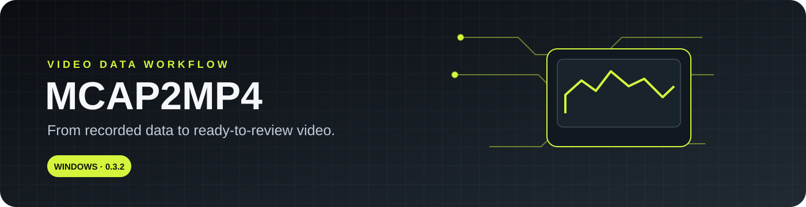

<div align="center">



# MCAP2MP4

### Turn MCAP recordings into MP4. Keep the workflow moving.

A Windows desktop application and CLI for converting MCAP camera recordings to MP4, with batch workflows, metadata reports, session handling, and a built-in playback experience.

[**Download Windows installer**](https://github.com/progstay17/Mcap2Mp4-converter-/raw/refs/heads/main/MCAP2MP4-Setup-0.3.2.exe) · [Installation guide](docs/INSTALLATION.md) · [Changelog](docs/CHANGELOG.md) · [Troubleshooting](docs/FAQ.md)


[](https://github.com/progstay17/Mcap2Mp4-converter-/actions/workflows/tests.yml)

</div>

---

## Built for real recording workflows

MCAP2MP4 is designed to help turn recorded camera data into files that are easier to review, share, and archive.

- **Convert** — remux supported H.265 video streams into MP4 without re-encoding.
- **Batch process** — queue multiple recordings and inspect conversion progress.
- **Review metadata** — inspect recording metadata and export reports.
- **Work with sessions** — detect and combine supported multi-file recording sessions.
- **Play back recordings** — use the built-in player for playlists and one- or two-camera review.
- **Choose your workflow** — use the Windows GUI for interactive work or the CLI for automation.
- **Use your language** — Indonesian, English, and Simplified Chinese resources are included.

> Feature availability depends on the recording format and the installed build. See the changelog for the exact changes in each version.

## Get started

<div align="center">

### Windows · v0.3.2

**Quickest path:** download the installer, run it, then launch MCAP2MP4 from the Start Menu.

[**Download MCAP2MP4-Setup-0.3.2.exe**](https://github.com/progstay17/Mcap2Mp4-converter-/raw/refs/heads/main/MCAP2MP4-Setup-0.3.2.exe)

</div>

1. Download the installer using the link above.
2. Run the .exe and follow the setup wizard.
3. Open MCAP2MP4 and select your .mcap recording.
4. Choose the output options, then start the conversion.
5. Review the output MP4 and any generated metadata or reports.

For detailed steps and troubleshooting, read the [installation guide](docs/INSTALLATION.md).

## GUI and CLI

| Need | Use |
|---|---|
| Convert files interactively | Windows GUI |
| Run a version check or automate a workflow | `mcap2mp4-cli.exe` |
| Inspect conversion options | Run `mcap2mp4-cli.exe --help` |
| Check the latest changes | [Changelog](docs/CHANGELOG.md) |

The command-line interface supports `--version`; consult `--help` from your installed build for the exact options available.

## Compatibility notes

- The main conversion path targets supported H.265 MCAP video streams, including supported Foxglove protobuf and ROS 2 CDR layouts.
- Conversion is designed around remuxing rather than re-encoding; unsupported codecs or message layouts may not convert.
- Two-camera playback and session workflows depend on the recording structure and available metadata.
- The installer bundles application components. Some optional dependencies, including the official latest libVLC package, may need to be prepared separately for certain builds.

If a file fails, keep the original MCAP unchanged and review the app output/logs before retrying. More help: [FAQ and troubleshooting](docs/FAQ.md).

## Build from source

Requirements: Python 3.12, Windows for the packaged installer workflow, and the project dependencies.

```powershell
py -3.12 -m venv .venv
.\\.venv\\Scripts\\Activate.ps1
python -m pip install -r requirements-dev.txt
python -m unittest discover tests
python -m mcap2mp4 --help
```

The Windows packaging workflow is in [`.github/workflows/build-windows.yml`](.github/workflows/build-windows.yml). See the `build/` directory for packaging scripts and the `docs/` directory for design and implementation notes.

## Project map

| Path | Purpose |
|---|---|
| `src/mcap2mp4/` | Application and conversion code |
| `tests/` | Automated tests and test fixtures |
| `docs/` | Product requirements, release notes, installation, and troubleshooting |
| `build/` | Packaging and Windows installer scripts |
| `i18n/` | Indonesian, English, and Simplified Chinese strings |
| `third_party/` | Bundled third-party utilities |

## Documentation

- [Installation and first run](docs/INSTALLATION.md)
- [FAQ and troubleshooting](docs/FAQ.md)
- [Release notes](docs/CHANGELOG.md)
- [Product requirements](docs/PRD_MCAP_ke_MP4_v0.2.md)
- [v0.3 session, audio, and player requirements](docs/PRD_v0.3_Sesi_Audio_Pemutar.md)

## Credits

Built by **Fadhil Ghifarion 法迪** for AIT.

---

<div align="center">

**MCAP2MP4** · Practical tools for reviewing recorded data.

</div>
